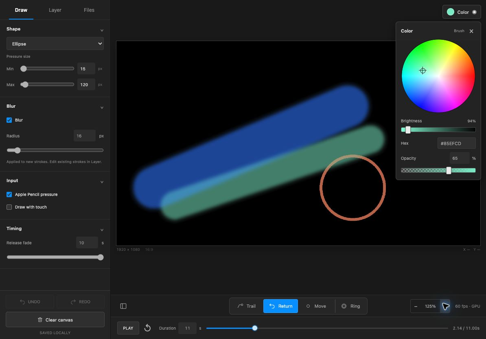

# 画面と描画検証の記録

## 現行版

- [操作画面](direct-painting-blur-palette-zoom.jpg)：DrawのBlur 16px、右上の円形カラーパレット、不透明度、125%ズーム。
- [ブラウザ検証と10レイヤー計測](blur-zoom-benchmark.json)：22項目成功。GPU / CPU画素比較、Blur、表示倍率・リセット、3000px、キャッシュ、コンテキスト復帰を含みます。

## 過去の段階

- `direct-painting-ipad.jpg`：単一キャンバスへの変更時。
- `direct-painting-left-panel.jpg`：左パネル統合時。
- `direct-painting-gpu.jpg` / `gpu-benchmark.json`：WebGL2移行時。ブラウザ検証15項目成功。
- `direct-painting-layer-effects.jpg` / `layer-effects-benchmark.json`：レイヤーエフェクト追加時。ブラウザ検証20項目成功。

過去の画像には現在廃止したUIも含まれます。現行仕様と確認範囲は[実装履歴](../docs/implementation-log.md)を参照してください。計測は記録されたPC・ブラウザでの描画時間で、iPad実機の入力遅延やFPSを保証するものではありません。
