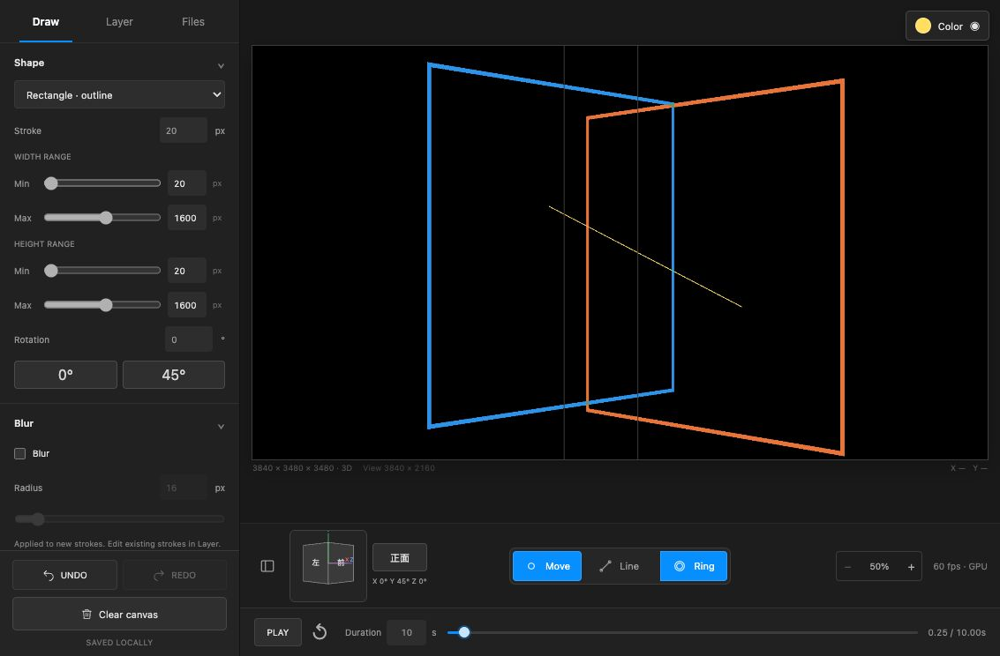

# 3DボックスとLine Ring

描画空間を3840×3480×3480にしました。キャンバス下の回転ボックスで向きを変えると、その向きで画面正面を向く新しい作業平面へ描きます。既存の図形は描いた平面と3D座標を保持します。回転を戻しても、異なる向きの図形が一枚の平面へ潰れることはありません。

作業平面はボックス中心を通ります。円・四角形は各ストロークの平面上の図形、Lineは異なる平面の終点を結ぶ3D線分です。ボックス外の図形は境界で切り取ります。現段階はボクセル、立体ブラシ、立体メッシュを塗る機能ではありません。透明な図形は奥から合成します。

初期100%は中央1920×1080、出力も常に1920×1080です。倍率は50〜500%。50%の表示範囲は3840×2160なので、高さ3480のボックスは上下へパンして使います。2本指のピンチ・パン・ひねり回転、回転ボックスの1本指操作を`/output`にも同期します。倍率ボタンは100%・中央・正面へ戻し、「正面」ボタンは向きだけを戻します。矢印キーは5°ずつ回転、Shift併用で画面内回転です。

四角形は初期状態で正方形、幅と高さのMaxは1600pxです。幅・高さの個別調整、0°／45°プリセット、数値での角度指定を残しています。既存の未変更デフォルト20〜100pxは一度だけ20〜1600pxへ移行し、編集済みの値は保持します。

LineではCircle RingのMin／Max、筆圧、Stroke、Blur、色、不透明度、リリースフェードを使います。入力中はペンを追い、離した後は通常のMove Ringと同じように消えます。各入力の最後の位置を2点として記録し、次の周回の最初の入力時刻から完成した直線を表示します。線幅はLineのWidthで別に指定します。MIDI頭出しやリスタート時には完成済みの直線を再生可能にします。

保存・読み込みとライブ転送には各ストロークの回転平面、3D終点、初回Ringのサンプルとタイミングを含めます。旧2Dデータは元の座標を保持して正面へ読み込みます。

## 検証

- `npm test`：空間座標、全周回転、カメラ正面への入力、平面の保存・検証、異なる奥行きのLine、矩形デフォルト移行などを確認。
- `/benchmarks/volume.html`：15項目成功。Lineの初回Ringと通常Move Ringを全画素比較し、筆圧・フェードの3時点で差0。90°／180°／複合回転後の描画、CPUフォールバック、視線と平行なLineの端も確認。
- 10レイヤー、各1600pxの矩形Ring、Blur16pxを全レイヤー表示したMac Chromeで平均2.10ms、p95 4.00ms。描画マスクの追加生成・CPU画像転送は0。iPad mini実機でのFPS測定ではありません。
- 1133×744の編集画面で、回転後の新規入力、2つの異なる平面を結ぶLine、Ringの消失、正方形初期値、下部回転UIを確認。保存座標の再投影は指定した画面座標と誤差0でした。

[GPU検証JSON](../artifacts/volume-render-checks.json)、[入力・3D座標](../artifacts/box-volume-ui-checks.json)、[出力画面](../artifacts/box-volume-output.png)を保存しています。

