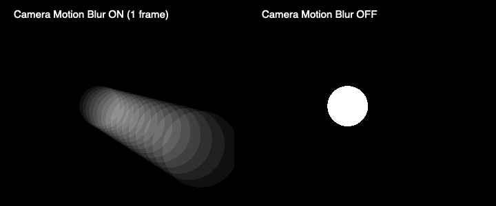

# カメラモーション

キャンバス下のCameraで **normal / rec / midi auto** を選びます。カメラは実際に3D空間を移動し、原点を向きます。描画平面は入力開始時の向きを保持するので、保存済みの図形も立体的に見回せます。編集中のストロークは同じ平面へ入力座標を逆投影し続けます。

## MIDI auto

1. MIDIタブの「入力デバイス（Mac）」で、MacにつないだMIDI入力を選びます。
2. Camera motionをONにします。下部のmidi autoも同時に選択されます。OFFにするとnormalへ戻ります。
3. 反応させたいノートを一度送ります。「反応するMIDIノート」に受信済み番号が追加されるので選択します。既定の24は未受信でも選べます。
4. Attack / Decay / Sustain / Releaseを調整します。単位は秒／秒／%／秒です。

Note Onを受けると、Macがランダムな方位・仰角・距離を1つ決定します。方位は全周、仰角は±55°、中心からの距離は4500〜8500です。カメラはボックスの外側を移動し、原点を向き続けます。midi autoではパンを中央に戻します。倍率は維持します。

初期ADSRは **0.4秒／0.3秒／65%／0.9秒**。Attackでランダム位置へ移動し、Decayで基準位置とランダム位置の65%の姿勢へ戻ります。Sustainはノートを保持している間の位置です。Note Offまたはベロシティ0で、現在位置からReleaseを使って基準位置へ戻ります。各区間は始点と終点の速度・加速度が0になる補間を使います。再トリガーも現在位置から始めます。ADSRを編集中の変更は次のNote Onから適用します。

全チャンネルを受け、最後に受けた対象ノートを1つのカメラ動作として扱います。別チャンネルのNote Offでは現在のノートを離しません。デバイス切替・切断はReleaseを開始します。ノートを変更すると、前の対象ノートの動作をReleaseします。回転ボックスは、指・キーボード・正面ボタンをすべてロックします。

**タイムラインの頭出しは引き続きノート24固定**です。カメラにも24を選ぶと、同じNote Onで頭出しとカメラ移動の両方が起きます。別のノートを選ぶと、カメラだけが反応します。カメラのADSRはノートの実時間で動き、タイムラインが一時停止中でも反応します。

## Rec

recを選んだだけでは録画しません。回転ボックスに触れると、前のテイクを置き換え、固定16秒のタイムラインを0秒から再生して録画を始めます。指を離すか16秒に達すると録画終了です。正面ボタン・キーボード操作も新しいテイクとして扱います。

録画後はタイムラインに沿って同じ角度を繰り返します。サンプル間を角度の最短経路で補間し、録画が短ければ残りは最後の姿勢を保持します。16秒境界ではテイクの最初へ戻ります。終点と始点が離れている場合の自動的なつなぎ足しはしません。滑らかな周回にしたい場合は最初の向きへ戻して録画を終えてください。

再び触れるたび撮り直しになります。記録するのは回転ボックスの姿勢で、パン・ズームは録画後も別に操作できます。一時停止・シーク・頭出しでも録画を終了します。モードをnormalへ変えると、その時点の姿勢で止まります。エフェクトやADSRを編集するだけでは録画を止めません。

## Camera Motion Blur

**Draw → Effects → Camera Motion Blur** は画面共通のエフェクトです。初期ON、Shutter 100%＝16.7ms、範囲0〜200%です。normalの手動操作、recの再生、midi autoのいずれにも対応します。レイヤーごとのMotion blurは図形自身の動きを担当し、独立してON/OFFできます。静止しているLineも、カメラが動けばCamera Motion Blurでにじみます。

GPUは8〜16個のカメラ姿勢を同じレイヤーのシェーダーで評価し、図形自身の動きと合わせて色・透明度を平均してからAnalog合成します。画面全体の残像画像やレイヤーごとの追加描画先は保持しません。rec／midi autoの露光姿勢は元の動きから計算し、手動操作では最大32個の短い姿勢履歴を使います。静止時は通常描画へ戻ります。

CPUフォールバックでも現行の円・矩形・3D Lineのカメラ露光を平均します。**旧Trail／Returnのビットマップ互換レイヤーに対するCamera Motion BlurはCPUでは未対応**です。通常の互換再生は継続します。

## 保存と同期

`settings.camera`へモード、対象ノート、ADSR、Blur設定、録画トラックを保存します。旧プロジェクトの初期値はnormal／ノート24／Camera Motion Blur ONです。録画は`track: {id, samples: [{t, view}]}`、先頭0ms、最終16000ms未満、最大2048サンプルです。画面は60Hzで更新します。

Macの`/api/camera`が設定・録画・MIDIイベントを管理します。MIDIのランダムな目的地を端末ごとに作らず、発生時刻・目的地・ADSRを編集画面と`/output`へ同じSSEで配信します。録画中は`/api/view`にテイクIDを付け、追加した点だけを配信します。古いテイクの遅延パケットや古いプロジェクト同期は、新しいカメラ状態を上書きしません。遅れて接続した出力は全状態を取得して復帰します。

カメラ設定と録画結果はJSON保存・読み込みと自動保存に含みます。録画の終了時にMac側へ保存し、各フレームで全プロジェクトをディスクへ書き込みません。Macの16秒タイマーは編集画面を閉じても録画を終了します。

## 確認範囲

- `npm test`：169件成功。カメラ位置・中心向き、入力の逆投影、ADSR、再トリガー、録画の置換と周回、古い状態の拒否、保存を含みます。うち3件はHappy DOMでUI操作を検証し、実際のエディター初期化とHTTPリレーを接続しています。画面のレイアウトを確認するテストではありません。
- `npm run test:midi -- artifacts/camera-midi-checks.json`：実CoreMIDI仮想入力の7項目成功。固定24の頭出し、対象ノートの変更、Note Off／ベロシティ0、切断時のReleaseを確認しました。
- `npm run test:motion-gpu -- artifacts/camera-shader-checks.json /tmp/direct-object-blur.png artifacts/camera-motion-blur-comparison.png`：Apple M4 MaxのmacOSオフスクリーンGPUで本番GLSLを描画し17項目成功。カメラの周回・ロール・距離・図形の動きとの併用・境界・横向きの平面・透明度・保存平面を含みます。独立した各姿勢の描画を平均した参照との差は、カメラの8項目で最大RMS 0.0334／255、境界の一部で最大16／255でした。[結果](../artifacts/camera-shader-checks.json)を保存しています。
- `npm run build`：成功。既存のThree.jsチャンクサイズ警告があります。

ブラウザー操作機能に接続できなかったため、実ブラウザーのThree.js／WebGL2統合、画面レイアウト、iPad mini A17 Proの操作・描画速度は未確認です。`/benchmarks/motion.html`にカメラの画素比較・16秒周回・実カメラの向きの検証も用意していますが、今回は未実行です。CoreMIDIの確認は仮想入力であり、実オーディオインターフェースやTouchDesigner本体の実機確認を含みません。

