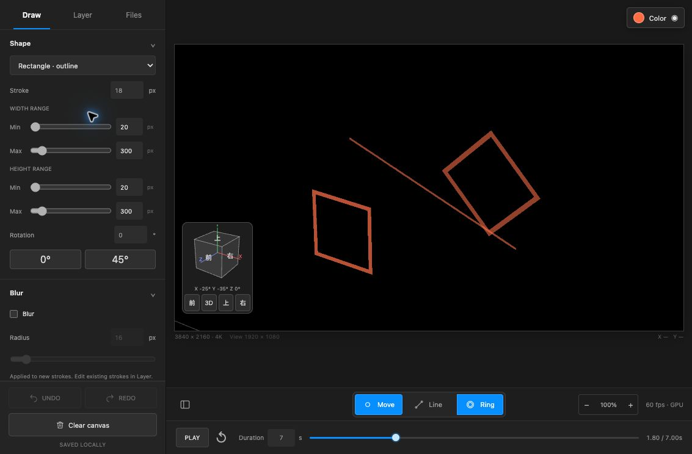
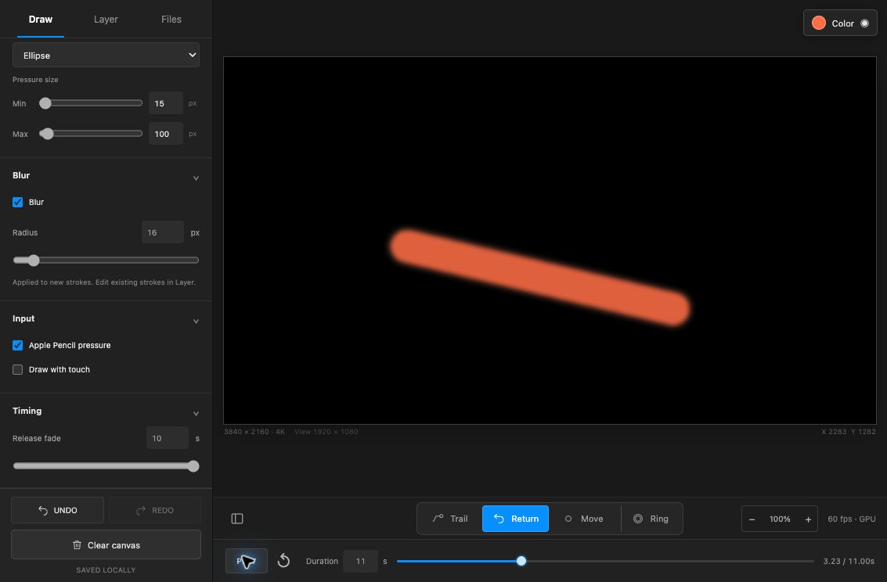
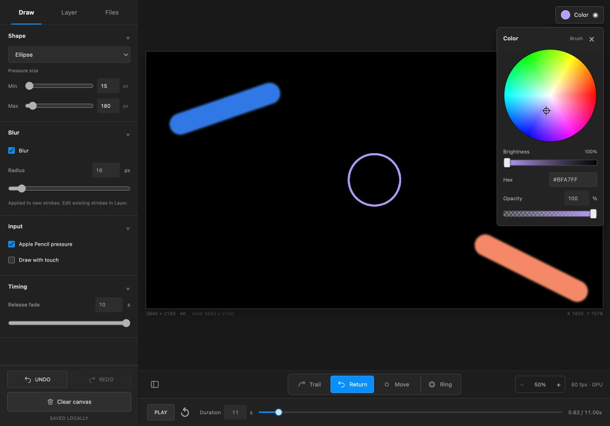

# 実装履歴と検証記録

## 現行仕様

direct-paintingは、iPad / Apple Pencilで描いた動きを4K（3840×2160）の単一描画領域で編集し、初期表示と`/output`は1920×1080・60fpsで配信するローカルツールです。

### 4K描画領域とFull HD表示

- 内部の描画領域は3840×2160、編集画面と出力の表示解像度は1920×1080です。
- 初期100%は4K中央の1920×1080（左上960,540）です。筆跡の座標は変更しません。以前の4K版の左上初期値は一度だけ中央へ移行します。
- 倍率は50〜500%。50%では正面の4K全体を表示します。2本指のひねり回転と、左下の回転ボックスによるX/Y傾斜に対応します。
- 上下限に達すると倍率の− / ＋ボタンは無効になります。倍率表示のボタンで100%・初期位置へ戻せます。
- 旧プロジェクトの10〜800%のカメラ設定は新しい範囲へ収め、筆跡の座標・サイズ・タイミングは保持します。
- この制限はピンチ、ボタン、出力へのライブ転送、JSON読み込みに共通です。

### Blur

- エフェクトはBlurのみ。初期ON、半径16px。
- DrawのBlurは次に描くブラシへ適用します。
- LayerのEffectsでは、記録済みの各レイヤーを個別にON/OFF・半径調整できます。
- 切り替えても元の筆跡を変更せず、GPUの形状キャッシュを再利用します。
- 過去のJSONにあるGlitch・色収差は無視します。明示的に保存されたBlur半径は保持します。
- 独立した縁色を廃止し、混色はAnalogに統一しました。Ringは塗り色で輪郭だけを描きます。

### 右上のカラーパネル

- Colorボタンと×で表示・非表示を切り替えます。
- 円形パレットで色相・彩度、下のバーで明るさを調整します。
- Hex入力と不透明度の数値・スライダーに対応します。
- Drawではブラシ、Layerでレイヤーを選ぶとその塗り色と不透明度を編集します。
- グラデーションBのスウォッチから、B色の編集へ切り替えられます。
- ブラシの不透明度は新しいレイヤーへ記録し、ライブ描画にも反映します。

### ピンチ・出力同期

- キャンバス上の2本指ピンチで50%〜500%の拡大縮小に対応します。
- 指の中点を保ちながら拡大縮小し、2本を同じ方向へ動かすと位置も移動します。
- Draw with touchがOFFでもピンチは使えます。
- 2本目の指が触れたときは描画から移動操作へ切り替え、指が1本だけ残った状態で誤って線が出ないようにしました。
- キャンバス下の− / ＋でも倍率を変更でき、倍率表示のボタンで100%・初期位置に戻せます。
- トラックパッドのピンチとCtrl＋ホイールにも対応します。
- ズーム中は画面座標を元の描画座標へ逆変換します。保存する筆跡の座標は拡大縮小で書き換えません。
- 表示倍率・位置は4Kの範囲内で`/output`にも反映し、JSONと自動保存に記録します。出力解像度は1920×1080のままです。
- 指入力は60fpsの描画周期へまとめます。`/api/view`とSSEで小さな変換情報だけを送るため、ピンチ中に全レイヤーを毎回送信しません。
- 通信のsession・revisionを検証し、古いスナップショットや遅れた更新で倍率が戻ることを防ぎます。

### 3000pxのサイズ

- 円の直径と矩形の幅・高さは最大3000pxです。
- Drawの筆圧範囲、Layerのサイズ編集、JSONの検証、再生、ライブ転送を同じ上限に揃えました。
- 大きなブラシは重複スタンプを減らし、CPU側のディスク形状キャッシュも上限を設けています。
- 細い矩形やRingでは、幅に応じた密度を保ちます。

## Gitに記録した実装段階

ローカルで保存していた実装段階を、それぞれ独立したコミットとして取り込みました。作業中の最新ファイルを巻き戻さず、各段階を別の一時ディレクトリで検証しています。

| 段階 | コミット | 主な内容 | 検証 |
| --- | --- | --- | --- |
| 描画基盤 | [106b551](https://github.com/santa-s4nt4/direct-painting/commit/106b551) | Full HD・単一キャンバス、左パネル、WebGL2、ライブ出力、Ethernet接続先、TouchDesigner設定 | 自動テスト131件、ビルド成功 |
| レイヤー機能 | [64e1b12](https://github.com/santa-s4nt4/direct-painting/commit/64e1b12) | レイヤー別エフェクト、Ring、Analog統一、動画書き出し・Preview・縁色の廃止 | 自動テスト124件、ビルド成功 |
| 現行の操作 | [c98df04](https://github.com/santa-s4nt4/direct-painting/commit/c98df04) | Blurのみ・16px、DrawのBlur、右上パレット、不透明度、共有ズーム、3000px | 自動テスト130件、ビルド成功、ブラウザ描画検証22項目成功 |
| 3Dビュー・描画ツール | [d029cbd](https://github.com/santa-s4nt4/direct-painting/commit/d029cbd) | 50〜500%、2本指回転、回転ボックス、四角形Ring、2点の直線、relay単独の周回処理 | 自動テスト143件、ビルド成功 |
| 3D・出力検証 | [9c3ffd2](https://github.com/santa-s4nt4/direct-painting/commit/9c3ffd2) | GPU/CPU比較、初回Ring・次周回、入力座標と保存・出力の検証記録 | ブラウザー描画比較33項目成功 |
| 中央表示・10% | [a378b5d](https://github.com/santa-s4nt4/direct-painting/commit/a378b5d) | 中央Full HD、10〜200%、旧初期位置の移行、縮小時の枠 | ビュー・JSON・SSE検証成功 |
| Trail負荷対策 | [6463438](https://github.com/santa-s4nt4/direct-painting/commit/6463438) | 範囲コピー・Blur、残像寿命内の再構築、端末本数計測 | 自動テスト135件、ブラウザ26項目、ビルド成功 |
| 4K対応 | [cc2556c](https://github.com/santa-s4nt4/direct-painting/commit/cc2556c) | 内部4K・初期Full HD、50〜200%制限、範囲外移動の防止、旧データ移行 | 自動テスト133件、ビルド成功、ブラウザ描画検証24項目成功 |

中間段階にあるGlitch・色収差・64pxの初期値は、現行仕様では使用しません。詳細な変更点は各コミットの本文にも記録しています。

## 3Dビュー・新ツール（2026-10-25）

Move / Lineへ整理し、四角形Ring・0°／45°・自由角度、50〜500%、2本指の回転、左下の回転ボックスを追加しました。PerspectiveCameraで描画面を傾け、ペン位置を同じ投影から逆算します。直線は最初の周回に端点Ring、次周回の最初のタップ時刻から全長を表示します。relay単独でも次周回への切り替えを進めます。

自動テスト143件、ブラウザー描画比較33項目、ビルド成功。操作・保存形式・確認範囲は[3Dツールの記録](3d-tools.md)に記載しました。

## 以前の中央表示・Trail負荷対策（2026-10-25）

自動テスト135件、ビルド成功、ブラウザ描画検証26項目が成功しました。10%表示と中央リセット、viewVersionによる旧初期位置の移行、`/output`への同期を確認しました。描画範囲を絞ったコピーとBlur、1800msのTrail再構築範囲、端末用の計測ページを追加しています。

M4 MaxのPCでは60秒・10本のシークが86msから3.9msへ短縮しました。iPad mini A17 Proの本数は未実測です。[原因・計測・暫定目安](trail-performance.md)に実測と推測を分けて記録しています。

[中央10%の画面](../artifacts/direct-painting-center-10.png)も記録しています。

## 以前の4K対応時の確認内容

4K対応版は、自動テスト133件とブラウザ描画検証24項目が成功しています。

`npm test`と`npm run build`を、コミット対象のファイル一式で実行しました。

- 2本指ピンチの倍率・中点・座標逆変換、片指を離した後の抑止、50〜200%の上下限と4Kの移動制限。
- 4K右下への描画、50%全体表示、1920×1080の初期出力、旧Full HD形式の座標維持。
- `/api/view`のSSE通知、後から接続した出力への反映、古い更新の無視、保存・リセット。
- HSVとHexの変換、色・不透明度・Blur・表示倍率を含むJSONの往復。
- 3000pxの描画・検証・ライブ転送と、上限を超える値の拒否。
- GPUとCPU基準の画素比較、Blurの個別適用、ズーム・リセット、GPUキャッシュ再利用、コンテキスト復帰、CPUフォールバック。

Chromeの実画面からも、パレットの開閉、円形パレットによるレイヤー色の変更、不透明度65%の描画、DrawとLayerのBlur、ズーム中の描画座標、Undo、100%への復帰、`/output`の同期を確認しました。

4K対応版の表示幅は1194×834と390×844で確認し、横方向のはみ出しがないことを確認しています。以前のパレット追加時には834×1194も確認しています。

[初期100%・1920×1080の表示](../artifacts/direct-painting-4k-default.jpg)も保存しています。

計測値は[ブラウザ検証JSON](../artifacts/4k-canvas-benchmark.json)に保存しています。このPCのChromeでは、4K描画領域・Full HD表示・10レイヤー・Blur有効のGPU描画が平均1.66ms、95パーセンタイル4.1msでした。描画処理の測定であり、入力・ネットワークを含む遅延やiPad実機のFPSを保証する値ではありません。

iPad実機でのマルチタッチとTouchDesigner本体での動作確認は含みません。ビルド時にはThree.jsを含む共有チャンクが500kBを超える旨の警告が出ますが、ビルドは成功しています。

## 保存対象

ソース、依存関係のロックファイル、ライセンス、テスト、設定、TouchDesigner用ファイル、画面・計測記録をGitに含めています。`node_modules`、`dist`、`.direct-painting`、旧`.imagraph`などのローカル保存データは`.gitignore`で除外しています。

起動・操作方法は[README](../README.md)、GPU構成は[描画基盤の説明](../src/render/README.md)、TouchDesigner設定は[接続手順](../TD/README.md)を参照してください。

## 2026-10-25：3Dボックス、Line Ring、MIDI頭出し

描画を3840×3480×3480の3D空間へ移し、各入力の画面正面の平面を保持するようにしました。Lineの初回表示はMove Ringの筆圧・追従・サイズ・フェードをそのまま使い、完成後は異なる平面の終点も3D線分で結びます。矩形の初期Maxは1600×1600、回転ボックスは下部UIへ移動し、プリセットは正面だけにしました。

GPUは保存済みMove／Lineを解析的な図形として描き、合成先をFull HDにしました。10枚の1600px矩形Ring＋Blur16pxの全レイヤーを表示した計測は平均2.10ms、p95 4.00ms、描画マスクの追加生成・CPU画像転送0でした。iPad実機の計測ではありません。

タイムラインは120 BPM・4/4・8小節＝16秒に固定しました。FilesにMacのMIDI入力選択とC1番号24／36を追加し、Note Onで停止中を含め先頭から再生します。CoreMIDIで受けるのでiPadのHTTP接続でも使えます。古いスナップショットによる頭出しの取り消しを防ぐtransport revisionを追加しました。

操作・実装・検証は[3Dボックス](box-canvas.md)と[MIDI同期](midi-sync.md)に記録しています。`npm test`153件、3Dブラウザー検証15件、既存描画の回帰検証33件、実CoreMIDI仮想入力による4件が成功しています。ビルド成功（既存のThree.jsチャンクサイズ警告あり）。実機の演奏入力、iPad実機のマルチタッチ、TouchDesigner本体は今回の確認対象に含めません。

## 2026-10-25：図形の直接選択とLine 30px固定

下部のMoveボタンをなくし、Ellipse / Rectangle / Line｜Ringにしました。円・四角形は移動の動作を固定で使い、図形を直接切り替えられます。Ringは区切り線の右に置き、図形間で選択状態を引き継ぎ、Line選択時には無効にします。

Lineの完成後の幅は30px固定にし、Draw／Layerの可変幅入力をなくしました。保存データの読込・旧左右の個別設定・出力サーバーでも30pxを適用します。初回の円Ringは従来のStrokeを保持します。単体テスト154件とビルド、ブラウザーでの各ボタン操作・Ringの継承・幅入力の廃止を確認しました。

## 2026-10-25：MIDIタブとカラーパネルの外側タッチ

MIDI設定をFilesから独立したMIDIタブへ移動し、Macへの接続方法、デバイス選択、C1番号、接続・受信状態を日本語で案内するようにしました。デバイスの受信処理は既存の仕組みを使います。

カラーパネルの外側でpointerdownを受けると自動で非表示にします。開閉ボタンとパネル内の操作は対象外です。イベントを止めないため、キャンバスの最初のタッチでも描画が始まり、ほかのボタンも1回で操作できます。単体テスト154件、ビルドとブラウザー操作で確認しています。

## 2026-10-25：MIDIノート12で頭出し

頭出し対象をノート番号12に固定しました。24／36の選択UIを固定値表示に置き換え、以前の設定からは入力デバイスだけを引き継ぎます。ノート12のNote On（ベロシティ1以上）で先頭から再生し、Note Off・ベロシティ0・旧24／36は無視します。16秒固定と全チャンネル受信は維持しています。

単体テスト154件、実CoreMIDI仮想入力の4項目、ビルドを確認しました。仮想入力ではノート12をチャンネル1／16から送り、先頭再生と停止中の再開、対象外ノートの無視を確認しています。
