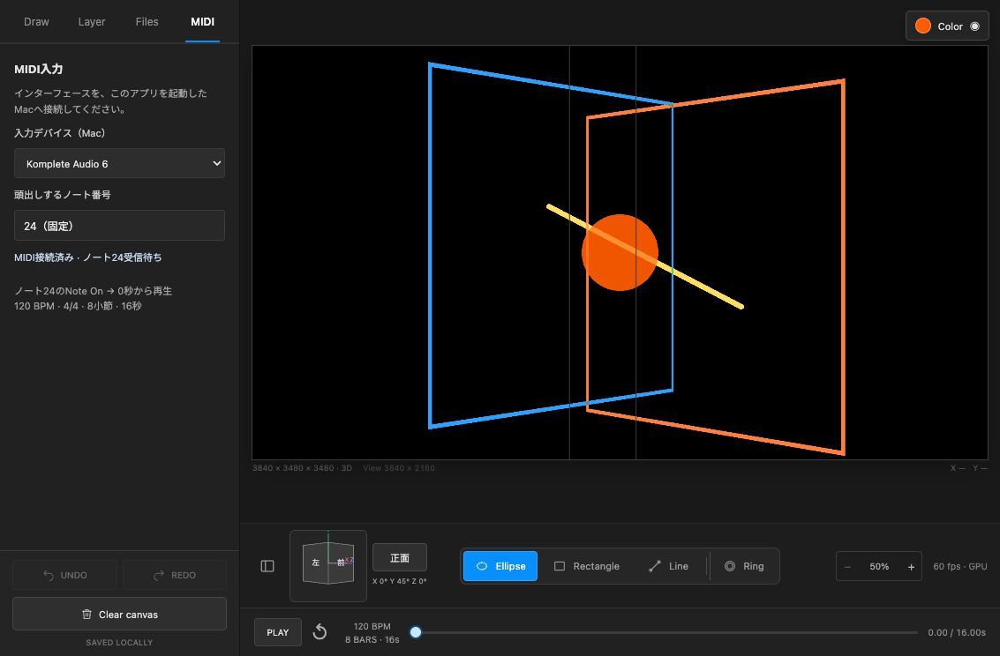

# MIDIと固定16秒のタイムライン

タイムラインは120 BPM、4/4、8小節の16,000ms固定です。可変Duration入力と、長い描画・フェードに合わせた自動延長を廃止しました。編集画面はFixedLoopClock、JSON読込はnormalizeProject、配信サーバーはvalidateSnapshotで同じ長さを適用します。旧プロジェクトの元サンプルは削除せず保持し、再生窓は16秒になります。

MIDIタブには、頭出しとは別に **Camera motion ON / OFF・反応するMIDIノート・変化させる項目・移動時間・イージング・拡大範囲** もあります。ノートを一度受信すると候補から選べます。Note Offやデバイス切断でカメラ移動は中断されません。[カメラの設定](camera-motion.md)を参照してください。

## 接続

MIDI端子のあるオーディオインターフェースをMacへ接続し、必要ならメーカーのドライバーでmacOSに認識させます。オーディオ信号そのものはMIDIとして受信できません。

`npm run dev`後、iPadまたはMacの左パネルにあるMIDIタブを開き、「入力デバイス（Mac）」の一覧から入力を選びます。別の機器を選ぶと、その入力へ切り替わります。「OFF（入力なし）」で入力を止めます。頭出しはMIDIノート番号24固定です。以前のノート12／36の設定が保存されていても、入力デバイスの選択を保持したまま24として読み込みます。受信ノート欄には実際のノート番号とチャンネル、受けた頭出し回数を表示します。

全チャンネルのNote Onのうち、ノート番号24と一致しベロシティが1以上のときだけ頭出しします。毎回0秒から再生を始め、一時停止中も再生になります。Note Off、ベロシティ0、他のノート、MIDI Clockは頭出しに使いません。テンポは常に120 BPMです。音源へのMIDI送信やMIDI出力ポートの作成は行いません。

入力の選択は`.direct-painting/loop.json.midi.json`に保存します。頭出し番号は24固定で、変更用のUIはありません。抜けた機器は切断表示にし、同じCoreMIDI Unique IDの機器が戻ると再接続します。IDが変わった場合は選び直してください。

## iPadと配信の同期

[Web MIDIの仕様](https://www.w3.org/TR/webmidi/)はsecure contextを要求するため、macOS側の[CoreMIDI入力ポート](https://developer.apple.com/documentation/coremidi/midiinputportcreatewithblock(_:_:_:_:))で直接受信します。iPadは既存のHTTP／Ethernetで操作でき、MIDIインターフェースはMacへ接続します。初回に`swiftc`で入力専用の補助プログラムを一時ディレクトリへ作成します。Xcode Command Line Toolsが必要で、macOS以外ではMIDI入力未対応を表示します。

サーバーが頭出し時刻とtransport revisionを確定してSSEで編集画面と出力へ通知します。古い編集スナップショットは、MIDI後の再生位置を上書きできません。編集画面が隠れていても出力側はサーバー時刻で再生します。再接続時は現在の状態を受け取り、編集中のローカルデータをMIDI受信だけで置き換えることはありません。

ブラウザー・OS・ネットワークの遅延はあるため、音声クロックとサンプル単位で同期する仕組みではありません。Note Onによる頭出しと固定テンポのループ再生です。

## 検証

`npm test`で、MIDIのパケット分割・running status・リアルタイムバイト混在・SysEx・チャンネル・Note Off、選択デバイスの絞り込み、設定の保存、固定16秒、古い同期更新の拒否、繰り返し頭出しを確認します。

Macでは次も実行できます。

```sh
npm run test:midi
```

この検証は専用の一時CoreMIDI仮想入力を作成し、別のテスト用サーバーで選択・受信します。既存のMIDI出力や実機へノートを送ることはありません。ノート24／チャンネル1と16、旧12／36やNote Offなどの無視、デバイス切断の4項目を確認して後片付けします。

[CoreMIDI検証結果](../artifacts/midi-native-checks.json)を保存しました。編集画面でも仮想ポートから受けて、停止→頭出し再生とデバイス切替を確認しています。Komplete Audio 6の列挙・入力接続を確認しました。実機からの演奏入力とiPad実機の通信遅延は未測定です。


