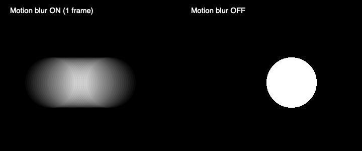

# BlurとMotion blur

通常のBlurはOFF、Motion blurはONを初期値にしました。DrawのEffectsは新規入力用、LayerのEffectsは選択したレイヤー用です。それぞれ個別にON/OFFできます。通常Blurの半径は従来どおり16px、Motion blurのShutterは100%＝60fpsの1フレーム（16.7ms）、上限200%＝33.3msです。

Motion blurは直近の短い時間幅を移動量に応じて8〜32段階でサンプリングし、移動・筆圧によるサイズ変化・矩形の回転を平均して描きます。停止した図形を常時ぼかす効果ではありません。完成したLineは静止しているので鮮明なまま、初回の円Ringは通常の移動図形と同じ効果になります。

新しいエフェクト設定を持たない旧プロジェクトは、最初の読込でBlur OFF／Motion blur ONへ移行します。Blur半径は保持し、以降の明示的なON/OFF・Shutterは保存・読み込みで保持します。ライブ転送と配信にも同じ設定を送ります。

## 描画処理

GPUでは現在の図形と同じ保存平面上で過去のサンプルを評価し、1つのシェーダーで被覆率と色・透明度を平均します。Analog合成はその後に一度だけ行うので、サンプルごとの重ね塗りによって不透明度や混色が強まることはありません。静止時は従来の描画へ戻ります。Blurを同時にONにした場合は平均した画像へGaussian Blurをかけます。

全画面の履歴テクスチャや保存レイヤーごとの追加画像は作りません。ライブ入力は実際に表示したペン先の位置を短く保持し、ストロークが変わると破棄します。保存後は記録した動きの時刻から再計算するので、再生順に依存せず、逆シーク・周回・MIDI頭出しの前の画像が残りません。

カメラの動きには、Draw → Effectsの独立した **Camera Motion Blur** を追加しました。初期ON／Shutter 100%です。8〜16姿勢を同じシェーダーで評価し、図形自身のMotion blurと合わせて平均します。2本指操作・回転ボックス・録画再生・MIDI autoのカメラ移動に反応します。[カメラの操作と確認範囲](camera-motion.md)を参照してください。以下の9項目の計測は、この追加より前の記録です。

CPUフォールバックも、投影した図形の色・透明度を加算平均してから通常Blurを適用します。旧Trail／Returnの互換再生は継続し、Motion blurの対象は移動する図形です。

## 検証と制限

- `npm test`：159件。新しい初期値、旧保存データの移行、明示的な設定のJSON往復、Shutterの時間幅とトリム境界、静止・非表示時、ライブ履歴の上限とローカル／ネットワーク一致、無効値の拒否を含みます。
- `npm run build`：成功。従来からのThree.jsチャンクサイズ警告はあります。
- `npm run test:motion-gpu`：macOSのオフスクリーンGPUで本番の頂点・フラグメントシェーダーをコンパイルして描画します。円、円Ring、回転矩形、矩形Ring、筆圧変化、3D平面、静止Ring、ボックス境界、透明度と色の9項目が成功。時刻ごとの通常描画を平均した参照画像との差は最大1／255です。[結果](../artifacts/motion-gpu-checks.json)を保存しています。
- `/benchmarks/motion.html`：WebGL2／Three.jsでの画素比較、ON/OFF、シーク、Blur併用、ライブ入力と配信、CPUフォールバック、動く10レイヤーの計測を用意しました。今回の環境ではブラウザー操作機能に接続できず、未実行です。実UIとiPad実機の確認も未実施です。

オフスクリーン検証は[AppleのCGLコンテキスト](https://developer.apple.com/library/archive/documentation/GraphicsImaging/Conceptual/OpenGL-MacProgGuide/opengl_pixelformats/opengl_pixelformats.html)を使う補助テストで、ブラウザーのWebGL2やThree.jsの実行を代替するものではありません。GPU処理の画素は確認しましたが、iPadの60fpsや入力遅延は今回計測していません。

